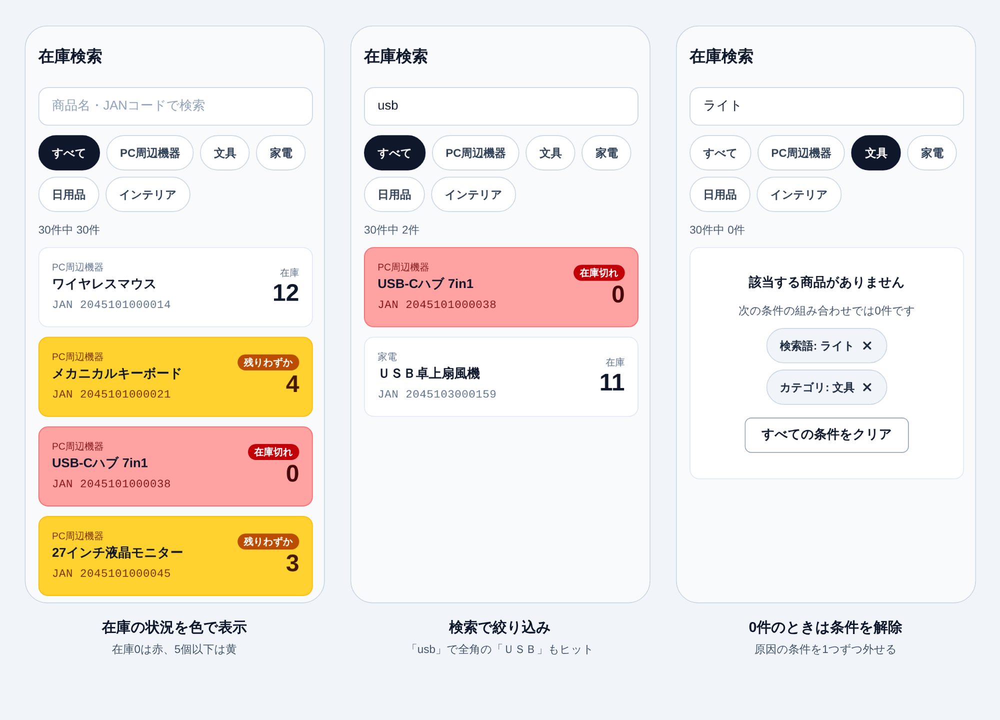
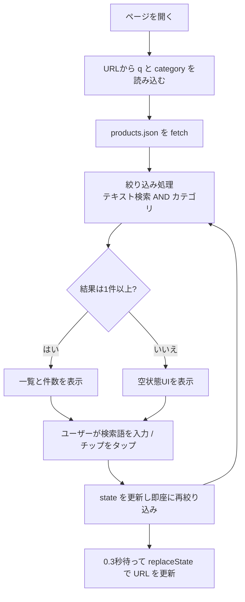

# 在庫検索アプリ(検索フォーム＋フィルタ表示)

案件No.06(初級・Webアプリ・1日/4時間)の実践練習プロジェクトです。

## 1. プロジェクトの概要

30件の商品データを一覧表示し、テキスト検索とカテゴリ絞り込みを1画面で行える在庫検索アプリです。検索条件はURLに保存されるため、リロードしても条件が保持され、URLを共有すると同じ検索結果を再現できます。



### 想定ユーザー

| 区分 | 誰が | 主な端末 | 使う場面 |
|---|---|---|---|
| メイン | 倉庫・売場の現場担当者 | スマホ | 棚の前や移動中に、片手で商品や在庫を確認する |
| サブ | 事務所の管理・受注担当者 | PC | 条件を絞った一覧のURLを現場にチャットで共有する |

### 機能要件

| No | 要件 |
|---|---|
| F1 | `products.json`(30件)を fetch して一覧表示する(カテゴリ → 商品名 → JANコードの順、在庫数を右側に大きく表示) |
| F2 | テキスト検索(商品名・JANコードの部分一致。NFKC正規化で全角/半角、大文字/小文字を区別しない) |
| F3 | カテゴリ絞り込み(タグ方式・単一選択。「すべて」チップで解除) |
| F4 | 検索条件を `?q=xxx&category=yyy` としてURLに保存し、リロードやURL共有で復元する |
| F5 | 結果が0件のときに空状態UIを表示する。今かかっている条件(検索語・カテゴリ)を示し、1つずつ外すボタンと「条件をクリア」ボタンを付ける |
| F6 | 「30件中 ○件」の件数表示 |
| F7 | 在庫状況に応じてカードの背景色とラベルを変える(在庫0は赤背景＋「在庫切れ」、1〜5個は黄背景＋「残りわずか」) |
| F8 | データ取得中は「読み込み中…」、失敗時はエラーメッセージと「再読み込み」ボタンを表示 |
| M1〜M6 | スマホ対応(幅375pxで崩れない、タップ領域44px以上、入力欄16px以上、1列表示、Enterでキーボードを閉じる。上部への固定(sticky)は、スマホ(768px未満)は検索欄だけ、PC・タブレットは検索欄とタグの全体) |

### 対象外(発展版で対応予定)

- 在庫数の入力・保存(Supabaseを使う想定)
- 発展版で保存先を切り替えやすいよう、データ取得処理は `lib/getProducts.ts` に集約する

### 開発ステップ

| Step | 内容 | 目安 |
|---|---|---|
| 0 | 要件定義(想定ユーザー、UI方式、スコープの決定) | - |
| 1 | プロジェクト作成(create-next-app + Tailwind)、サンプルJSON 30件の作成 | 30分 |
| 2 | `lib/getProducts.ts` でデータを取得し一覧表示(スマホ1列/PC複数列) | 30分 |
| 3 | テキスト検索とタグ方式のカテゴリ絞り込み | 50分 |
| 4 | URLクエリ同期とSuspense対応 | 40分 |
| 5 | 空状態UI、件数表示、スマホ対応の仕上げ | 40分 |
| 6 | 検証(DevToolsと実機)とREADME更新 | 50分 |

## 2. 使用技術

| 分類 | 技術 | 用途 |
|---|---|---|
| フレームワーク | Next.js (App Router) | 画面構成、ルーティング |
| 言語 | TypeScript | 型による安全な実装 |
| スタイル | Tailwind CSS | レスポンシブ対応、UI作成 |
| 状態管理 | URL searchParams / React state | 検索条件の保持と共有 |
| データ | JSON(`public/data/products.json`) | サンプル商品データ30件 |

### データ構造

```json
{ "id": 1, "jan": "2045101000014", "category": "PC周辺機器", "name": "ワイヤレスマウス", "stock": 12 }
```

| 項目 | 型 | 内容 |
|---|---|---|
| `id` | 数値 | 商品の番号(1〜30) |
| `jan` | 文字列 | JANコード13桁。先頭の0が消えないよう文字列で持つ。サンプルは実在商品と重ならないよう、店内用コードの先頭「20」を使用 |
| `category` | 文字列 | PC周辺機器 / 文具 / 家電 / 日用品 / インテリア の5種類 |
| `name` | 文字列 | 商品名 |
| `stock` | 数値 | 在庫数(在庫0の商品が5件、1〜5個の商品が7件) |

表記ゆれの検証用に、全角英字(「ＵＳＢ卓上扇風機」「ノートＰＣスタンド」)と半角カナ(「ﾍﾟｰﾊﾟｰﾀｵﾙ」)の商品名を意図的に入れています。

## 3. 全体のフロー



### ディレクトリ構成

```
app/
├─ layout.tsx               … lang="ja"、タイトル、ライト固定の背景
├─ page.tsx                 … Suspense で SearchPage を包む
└─ globals.css              … Tailwind の読み込み、日本語フォント
components/
├─ SearchPage.tsx           … "use client"。データ取得・読み込み中/エラー表示・state・URL同期
├─ SearchForm.tsx           … 検索欄とカテゴリチップ(Step 3)
├─ ProductList.tsx          … 商品カード一覧(スマホ1列 / タブレット2列 / PC3列)
├─ ProductCard.tsx          … 商品1件分のカードと在庫ラベル
└─ EmptyState.tsx           … 0件時の表示(Step 5)
lib/
├─ types.ts                 … Product 型と「残りわずか」の基準値
├─ getProducts.ts           … データ取得(発展版でSupabaseに切り替え)
└─ filterProducts.ts        … 絞り込みロジック(純粋関数、Step 3)
public/data/products.json
```

## 4. 学んだ事

詳しい内容は [docs/learning-notes.md](docs/learning-notes.md) にまとめています。

- 案件文に書かれていないユーザー像を、市場背景と要件から逆算して定義した
- 100ms要件のため、絞り込みはサーバーではなくクライアント側で行う設計にした
- URLを「状態の保存場所」として使い、履歴を汚さないよう `push` ではなく `replaceState` を選んだ
- 現場担当者のスマホ利用を想定し、スマホ対応を正式な要件に追加した
- `useSearchParams` を使うコンポーネントは `<Suspense>` で囲む必要がある(囲まないとビルドが失敗する)。開発中はエラーが出ないので、`npm run build` で確認する
- 「100ms以内」は、測る場所で数字の意味が変わる。アプリ内とブラウザの2通りで、CPUを遅くしたスマホ相当の条件でも測り、全体の最大値だけでなく操作ごとの内訳も確認した
- 在庫入力は「保存先」の問題でスコープが大きく変わるため、発展版に切り出した
- 表示項目は「現場の人が何を見て判断するか」で絞り込み、検索対象も表示項目と一致させた
- 絞り込みの処理は、画面から切り離した純粋関数(`lib/filterProducts.ts`)にして、動作を確認しやすくした
- 入力欄の値はstateで持ち、URLへは `replaceState` で書き込むだけにした。日本語入力の変換中に文字が乱れず、履歴も増えない
- 実在しないカテゴリがURLに書かれていても壊れず、「すべて」として扱ってURLも直す

## 5. こだわった点

- **ユーザー像からUIを決めた**: 現場担当者がスマホの片手操作で使うことを想定し、選択肢が常に見えて1タップで切り替えられるタグ方式・単一選択を採用した。
- **現場で必要な情報だけをカードに載せた**: 価格と説明文は外し、「カテゴリ → 商品名 → JANコード」と在庫数に絞った。在庫数は右側に大きく表示し、在庫切れはカード全体を赤、残りわずかは黄の背景にして、一覧をスクロールしながらでも在庫状況がひと目でわかるようにした。配色は明るい倉庫や売場で見やすいライト固定にした。
- **JANコードで探せるようにした**: 現場では商品のバーコード番号で探す場面があるため、JANコードを表示し、検索対象にも含めた。
- **事務所と現場をURLでつなぐ**: PCで絞り込んだ条件をURLで送れば、スマホで同じ結果が開けるようにした。
- **空状態をわかりやすくした**: 「0件なのか壊れているのか」で迷わせないよう、メッセージを表示する。さらに、0件の原因は「文具」×「ライト」のような条件の組み合わせであることが多いので、今かかっている条件を示し、1つずつ外せるようにした(「すべての条件をクリア」ボタンも用意)。AIが3つの案を出し、その中から自分で選んだ。
- **スマホの画面を広く使えるようにした**: 一覧をスクロールしても検索欄だけは上部に固定し、タグは固定しない。タグまで固定すると画面の約30%を占めてしまうため。PC・タブレットでは、場所に余裕があるので両方を固定する。
- **発展を見越した構成**: データ取得を `lib/getProducts.ts` に集約し、後からSupabaseへ切り替えやすくした。

## 6. 改善点

- 在庫数の入力・保存機能(Supabase)を発展版で追加する
- ひらがな/カタカナの表記ゆれ(「まうす」で「マウス」がヒット)への対応
- 商品数が増えた場合のページネーションや、サーバー側での絞り込みへの切り替え
- スマホのカメラでバーコードを読み取ってJANコードを入力できるようにする
- 商品数が増えたときの、スペース区切りの複数語検索への対応(現在は1語のみ)

## 7. 検証結果

本番ビルド(`npm run build` → `npm run start`)で確認しました。開発用(`npm run dev`)は動作が遅くなるため、数字の計測には使っていません。

### 自動テスト(Playwright)

| 達成基準 | 検証方法 | 結果 |
|---|---|---|
| 100ms以内に絞り込み結果が更新される | ①アプリ内の計測(`performance.now()`で、入力から画面更新まで)②ブラウザの計測(Event Timing、入力から次の描画まで)。スマホを想定して、CPUを通常・4倍・6倍遅くして測定 | **OK** ① 最大2.4ms(通常)/ 8.7ms(4倍遅い)/ 19.8ms(6倍遅い)② キー入力・タグのタップ・入力の反映は、6倍遅くても最大56ms |
| 検索条件を含むURLを共有すると同じ結果が再現される | 新しいブラウザ環境で `?q=usb&category=家電` を開く。PC幅(1280px)で作ったURLをスマホ幅(375px)で開く。リロードする | **OK** どれも同じ1件(ＵＳＢ卓上扇風機)。検索語・カテゴリ・結果がリロードで復元される。連続入力しても履歴の数は増えない |
| 結果0件のときに空状態UIが出る | `zzz` の検索、「ライト」×「文具」(条件2つ)、`?q=zzz&category=家電` を直接開く | **OK** 条件の数に合わせた文言とボタンが出る。条件を1つずつ外す・すべてクリアすると、URLも更新される |
| 不正なURLでも画面が壊れない | `?category=存在しない値`、`?q=&category=`、`?q=usb&category=存在しない値`、検索語 `A&B=C?#` | **OK** 不正なカテゴリは「すべて」になり、URLからも消える。検索語は残る。特殊文字も復元される |
| M1 幅が狭くても崩れない | 幅320 / 360 / 375 / 414 / 768 / 1280pxで横スクロールを確認 | **OK** すべて横スクロールなし |
| M2 タップ領域が高さ44px以上 | 通常表示(7個)と空状態(10個)の、すべてのボタン・入力欄の高さを測定 | **OK** 最小44px |
| M3 入力欄の文字サイズが16px以上 | 検索欄の文字サイズを取得 | **OK** 16px |
| M4 スマホでは検索欄だけ上部に固定、PC・タブレットでは全体を固定 | 下までスクロールして、検索欄とタグの位置を確認。境界の幅767pxと768pxも確認 | **OK** スマホ(〜767px)は検索欄だけ(高さ64px)、768px以上は検索欄とタグの両方が固定される |
| M5 スマホ1列、PC複数列 | 幅375 / 767 / 768 / 1023 / 1024 / 1280pxで列数を確認 | **OK** 1列 / 1列 / 2列 / 2列 / 3列 / 3列 |
| M6 Enterでキーボードを閉じる | 検索欄でEnterを押し、フォーカスが外れるかを確認 | **OK** フォーカスが外れる(実機のキーボードは手動で確認) |

**100msの計測について**: アプリ内の計測は、画面を更新するReactの処理が終わるまでの時間です。ブラウザの計測(Event Timing)は、画面に描画されるまでを含みます。ブラウザの計測で100msを超えたのは、ページの読み込み直後に起きたマウスホバーのイベント(4倍遅い設定で136ms、6倍遅い設定で104ms)だけで、検索の操作ではありません。CPUを遅くした測定は、実機の代わりではなく目安です。

### 手動確認(自分のPC・スマホ実機)

PCとスマホの実機で確認した結果です。確認した端末は、iPhone 17とAndroid端末です。

| 項目 | 方法 | 結果 |
|---|---|---|
| 100ms以内に更新される(PC) | `npm run start` で起動し、ブラウザのコンソールに出る `[検索] 入力→画面更新 ○ms` を確認 | **OK** 最大4.7ms |
| 100ms以内に更新される(スマホ) | 入力しながら、結果が遅れずに変わるかを確認 | **OK** 問題なし |
| URL共有で同じ結果が再現される | 条件付きURLをコピーして、シークレットウィンドウで開く | **OK** |
| PCで作ったURLがスマホで同じ結果になる | PCからスマホへURLを送って開く | **OK** |
| 0件で空状態UIが出る | `zzz` で検索 | **OK** |
| 不正なURLでも壊れない | `?category=存在しない値` をアドレスバーに入力 | **OK** |
| 入力欄をタップしても画面が拡大されない(M3) | iPhoneで検索欄をタップ | **OK** |
| タグやボタンが押しやすい(M2) | 片手で操作 | **OK** |
| Enterでキーボードが閉じる(M6) | 検索欄に入力してEnter | **OK** |
| 検索欄が上部に固定される(M4) | 下までスクロール | **OK** |

## 8. セットアップ

Node.js 20.9以上が必要です。

```bash
git clone https://github.com/kasiyuha9528/search-filter.git
cd search-filter
npm install
npm run dev
```

ブラウザで `http://localhost:3000` を開きます。

| コマンド | 用途 |
|---|---|
| `npm run dev` | 開発用に起動する(コードを直すと自動で反映される) |
| `npm run build` → `npm run start` | 本番用に作って起動する。速度の計測やスマホ実機での確認は、こちらで行う |
| `npm run lint` | コードのチェック |

スマホの実機で確認するときは、PCと同じWi-Fiにつないで `npm run start` で起動し、`http://PCのIPアドレス:3000` を開きます。

## 9. ライセンス

[MIT License](LICENSE)
